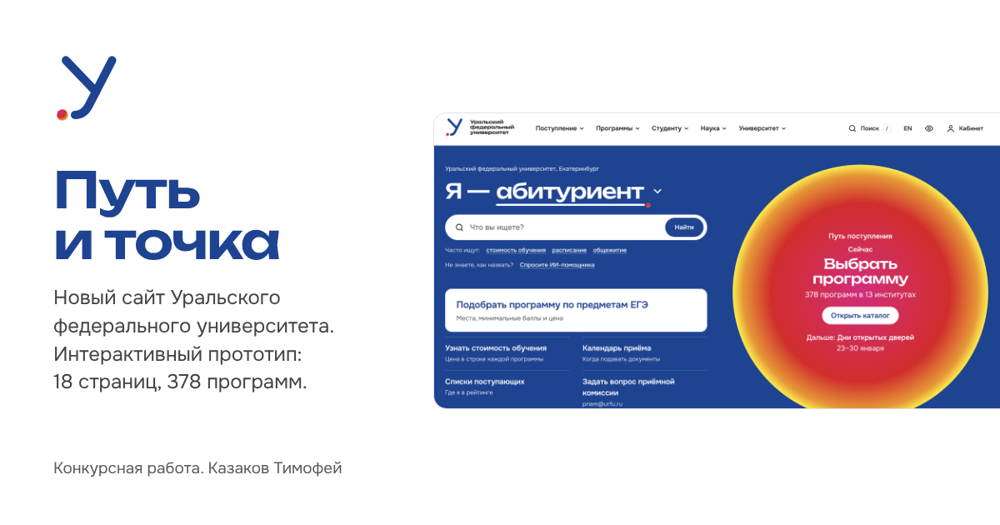

# «Путь и точка»: новый сайт УрФУ

Интерактивный прототип нового сайта Уральского федерального университета. Работа на конкурс «Взломай веб-дизайн университета», 2026.

**Открыть сайт:** https://quiljsss.github.io/urfu-redesign-site/

**Видео на 60 секунд:** https://quiljsss.github.io/urfu-redesign-site/video/put-i-tochka.mp4

## Что попробовать

- На главной выберите, кто вы: абитуриент, родитель, студент, гость из другой страны. Задачи и шаг «Сейчас» в солнце поменяются.
- В [каталоге](https://quiljsss.github.io/urfu-redesign-site/katalog.html?ege=mi) отметьте свои предметы ЕГЭ: останутся программы, куда с ними можно поступить, сразу с местами и ценой.
- На [странице программы](https://quiljsss.github.io/urfu-redesign-site/programma.html?id=9796) впишите свои баллы. Сайт покажет, пройдены ли минимумы, и цену со скидкой.
- Найдите аудиторию по коду из расписания, например [«Т-207»](https://quiljsss.github.io/urfu-redesign-site/kampus.html?q=T-207).
- Включите версию для слабовидящих: значок глаза в шапке.
- Посмотрите [главную в другой день приёма](https://quiljsss.github.io/urfu-redesign-site/?date=2027-01-25): дату задаёт `?date=` в адресе.

## Что внутри

18 страниц на компьютере и телефоне: главная, «Поступление», каталог из 378 программ, страница программы, институты, «Кампус и общежития», «Студенту», «Наука», «Университет», «Документы и сведения», «Помощь и контакты», ИИ-помощник, поиск, личный кабинет, английская версия, страница 404, знак и фирменный стиль.

Цифры взяты из документов УрФУ: каталога программ, плана приёма 2026 года, перечня вступительных испытаний и приказа о стоимости обучения № 1122/03. Фотографии с urfu.ru.

## Знак «Путь и точка»

Буква «У», хвост которой становится дорогой, и точка. На сайте знак работает в интерфейсе: точка отмечает, где вы сейчас, а дорога ведёт по разделам.

## Как открыть у себя

Скачайте репозиторий (Code → Download ZIP), распакуйте и дважды щёлкните по `index.html`. Сборка не нужна.

## Автор

Казаков Тимофей Александрович, студент 1 курса УрФУ, направление «Международный и корпоративный менеджмент», группа ЭУ-163603.

Почта quiljsss@mail.ru, Telegram [@quajybonc](https://t.me/quajybonc).

## Права

© 2026 Казаков Тимофей Александрович. Все права на концепцию, знак «Путь и точка», структуру, дизайн и код принадлежат автору. Лицензия на использование не предоставляется. По вопросам использования и внедрения пишите автору.

Название, товарные знаки, фотографии и тексты УрФУ принадлежат ФГАОУ ВО «УрФУ имени первого Президента России Б. Н. Ельцина» и используются только для показа концепции. Это не официальный сайт университета. Шрифты Unbounded и Onest распространяются по лицензии SIL Open Font License 1.1.
